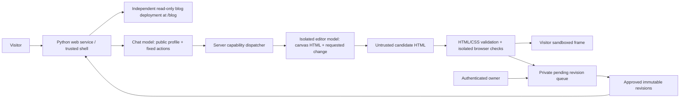

# Homepage behavior and guardrail plan

## Current milestone: local editing prototype

Optional owner-only local ChatGPT editing is implemented. Its two-pass pipeline,
diagram, setup, golden sets and limits are in [local-llm.md](local-llm.md).
Real account authorization and inference verification remain pending. The
production browser/content checks and review queue below remain a plan.

Implemented locally: Python serves the trusted shell at `/`, a chat streams
scripted replies over SSE, and an opaque-origin sandboxed iframe displays the
homepage. Reset lives in the shell and cancels pending output, clears the chat,
and restores the built-in original. Blog content is built for `/blog/` by
`pnpm build:site`. The standalone blog still defaults to `/`.

The demo offers factory, lilac, forest, and sunset colors plus blank, headline,
magazine, and studio layouts. Its restrictive
fragment validator supports only known presentation tags and classes, and has
no public arbitrary-HTML endpoint. It is not a general HTML sanitizer. There is
live model in demo mode, résumé, persistent revision queue, owner dashboard, or random
public rotation yet. Presets stay in memory in the visitor's tab. The Python
standard-library transport binds only to loopback and is for development.

Local editing uses ChatGPT plan OAuth; public provider choice is deferred. GitHub and Portfolio both point to
`https://github.com/aether-sky`. The résumé will be supplied later. Public contact:
`me@aether-sky.cloud`. Do not publish inferred personal details.

## Persona and facts

The original `Tadaima voice` was located in the owner's Claude output styles,
at `C:/Users/sky/.claude/output-styles/tadaima-voice.md`, and copied byte for byte
to `services/home/prompts/tadaima-voice.md` (SHA-256
`A2A655745E892035511B4B687C4A53F5C72BBDE1E473468C243FCC1CAC6394D5`).
`website-policy.md` adapts its use for a public host: warmth and playful
self-corrections, no claim to be the real streamer or Sky, no fabricated life
stories, and no gendered teasing or innuendo toward strangers. The copied voice
is used in the local request model prompt with a public-appropriate override;
the demo's replies remain authored fixtures.

On first arrival, stream only the Tadaima-voiced version of "You've landed on
aether-sky's homepage. How can I help you?" in the introduction area. The input
is prefilled with "I hate your website..." as editable text, not a placeholder.
No feature tour, labels, hints, or other
initial visible copy: the factory canvas is blank and controls use accessible
icons. Visitors discover the capabilities through conversation. Blog and GitHub/
portfolio requests redirect after the reply completes; bio requests display the
public blurb in chat. Keep chat output plain text. A blurb
is returned in chat, not emailed. Show `mailto:` only as a visitor-activated link.

When the résumé arrives, create a reviewed **public profile**, separate from the
private original: generalized roles, skills, work areas, approved accomplishments,
and this email. Remove names of employers/clients, precise dates, locations,
phone numbers, addresses, and identifying combinations unless explicitly
approved. Get the owner's approval of the actual public text before enabling
it. Calling it anonymized does not make it anonymous when linked to a GitHub
account and email; the practical objective is controlled disclosure.

## Runtime separation

Deploy the model/editor worker without repository mounts, blog files, Git
credentials, deployment credentials, cloud instance metadata, arbitrary tools,
or access to the owner's private files. Restrict its egress to the selected
provider. Keep the service's API key out of all prompts and browser responses.
Give the validator/browser worker no network and strict process, CPU, memory,
file, and time limits. The local preview's optional read-only blog artifact path
is a convenience, not the future editor's deployment arrangement.

Run production Python behind an ASGI server and reverse proxy with TLS, request
size/time limits, trusted host configuration, connection limits, and streaming
buffering disabled. Bound per-session/IP and global request, token, output,
concurrency, storage, and monetary budgets; rate-limit before calling a model.
Handle disconnect/cancel by cancelling upstream work, not just hiding its reply.

## Capabilities the server may execute

| Capability | Model output | Server behavior |
| --- | --- | --- |
| About Sky | Plain text grounded in approved public profile | Return in chat; never retrieve private résumé |
| Blog | `navigate: blog` | Redirect to fixed `/blog/` after a visitor's request |
| GitHub / portfolio | `navigate: portfolio` | Redirect to fixed `https://github.com/aether-sky` after a visitor's request |
| Edit | `edit_canvas: { request, base_revision }` | Supply current validated canvas HTML to tool-less editor model; receive candidate HTML |

Use strict schemas and reject unknown fields/actions. Never accept an arbitrary
URL, path, shell command, tool name, publication flag, or approval decision from
the model. Navigate only in response to a visitor's explicit destination request,
never a mere mention or generated HTML. The model may describe the result, but only the
dispatcher can report that an edit was accepted.

The current conversation is a discovery game. An initial color suggestion can
be accepted, but subsequent edits require the visitor's direction. Unrelated
tasks get an authored "not your servant" reply; denials say "I can’t help with
that." Only direct capability questions get a vague résumé/blog/GitHub/edit hint.
Asking what can change gets a question back, never an edit. Completed edits do
not reveal a menu. The frame changes only after validation and a complete stream.

Demo state travels as a strictly bounded object containing preset theme/layout,
pending suggestion, legacy invitation flag, and known seen-behavior IDs. It is local UX context, not a security
credential or authority. The browser commits it only after a complete response.
Production must associate authoritative accepted revisions with
the server-side session; never let client state or a model self-certify acceptance.

Owner-authored dialogue and edit transitions now live in validated TOML under
`services/home/behaviors`. The catalog is read only at service startup, never from
visitor input. Easter eggs support exact phrases, authored text variants, priority,
and once-per-conversation or unlimited replies. They have no executable effects.
Core actions and pending decisions take precedence over eggs; reset clears seen
IDs, and incomplete streams do not consume them. See the
[authoring guide](../services/home/behaviors/README.md). TOML can select only
renderer-owned presets; it cannot add action types or weaken the sandbox.

The editor receives **only the iframe document**, never the chat, reset button,
outer shell, secrets, or blog. Treat both the request and existing HTML as
untrusted. Do not turn comments, page text, CSS, previous responses, or approved
designs into system instructions. Prompt-injection detection is an extra signal;
the capability limits must hold even when both models fully obey an attacker.

## HTML in, HTML out: acceptance pipeline

1. Capture a session ID, monotonic generation number, and base revision hash.
   Bound request length, input HTML, output bytes, tokens, duration, and number
   of retries. Abort on any limit. Keep the last accepted canvas while waiting.
2. Stream conversational text only. Buffer the entire candidate HTML on the
   server. Never display tokens from incomplete model HTML.
3. Parse with a maintained HTML5 parser; normalize and rebuild a document from
   allowed nodes. Pin and audit the parser/sanitizer. Do not use a regex blacklist
   or the demo's `HTMLParser` gate as the general live-editor sanitizer.
4. Start with presentation-only HTML and CSS: semantic sections, headings,
   paragraphs, lists, tables with headers, and bounded layouts. Reject scripts,
   event attributes, links/navigation, forms/inputs, `contenteditable`, frames,
   embeds, objects, SVG, MathML, custom elements, base/meta/link tags, URL-bearing
   attributes, `srcdoc`, downloads, and browser permission requests. All real
   navigation and contact actions remain in the shell. Add capabilities later
   only with explicit policy and tests.
5. Parse CSS with a maintained CSS parser. Allow only selected properties and
   bounded values. Reject imports, external fonts, URLs (including escaped and
   nested syntax), animations, transitions, fixed/sticky overlays, dangerous
   containment, and unsupported at-rules. Bound selector count, nesting,
   complexity, node count/depth, content size, dimensions, and render cost.
   CSS does not become trusted because it contains no JavaScript.
6. Assemble a fresh document with a service-owned title, language, charset,
   viewport, and CSP placed before all content. The model cannot supply these.
   Use a dedicated uncredentialed render origin for persisted designs with
   HTTP CSP including `sandbox` and `frame-ancestors` restrictions; keep
   `<iframe sandbox="">` with **no** allow flags. No cookies, storage, referrer,
   forms, scripts, popups, top navigation, downloads, or network destinations.
   Forbid child links entirely: sandbox alone does not block all self-navigation.
   Do not accept `postMessage` commands from the frame.
7. Render the rebuilt HTML in a disposable, network-denied browser. Check no
   outbound requests, navigation, dialogs, downloads, resource exhaustion, or
   outer-page effects. Check semantics, contrast, reflow at 320 CSS pixels,
   200% text size, text spacing, reduced motion, and keyboard behavior. Include
   several viewport sizes and engines. Reject inaccessible or timed-out output.
8. Moderate visible content and extracted text for phishing, impersonation,
   credential collection, harassment, identifying information, prohibited
   content, and misleading claims about Sky. A technically inert phishing
   message can still harm a visitor. Use both explicit rules and a separately
   scoped content classifier; ambiguous results require review.
9. Reparse serialized output and validate again. Store immutable sanitized
   bytes, hash, policy version, provenance, and test results. Deliver only if the
   session/generation/base revision still match. Otherwise discard the stale
   response. A rejected candidate leaves the previous page untouched and gives
   a short reason in chat.

“However they want” means creative freedom inside these presentation limits.
Arbitrary executable HTML and a strong hostile-action boundary are incompatible.
If interactive generated apps become a goal, design a separate execution sandbox
and permission model before granting scripts.

## Queue and owner curation

Automatically place each accepted revision into a **private pending queue**,
after telling visitors that accepted designs are submitted to Sky for review.
Do not save ordinary conversation text by default. Store only the sanitized
HTML, safe thumbnail, revision/hash, policy version, timestamps, a bounded edit
summary (if needed), and test findings. Redact personal information and reject
secrets before retention. Set a retention limit (proposed: 30 days pending),
maximum queue size, per-session quotas, and duplicate-hash suppression. Clear
discard/delete controls must remove retained content according to that policy.

States: `pending → approved | rejected`; `approved → revoked`. Only authenticated
owner actions can approve, reject, revoke, or set selection weight. Use a private
admin origin, strong authentication, CSRF protection, audit logs, and server-side
authorization on every mutation. Never load pending HTML in the admin origin's
DOM. Review in the same constrained render origin; reviewers are attack targets
too. Escape metadata and queue labels as plain text.

Pick randomly from the current approved, non-revoked, policy-current set once
per new visit. Serve an immutable revision for that session, rather than rotating
under someone's cursor. The factory version is always available and is the
fallback for an empty pool, failed lookup, expired policy, or failed render.
Revalidate on approval and after any policy/parser update; approval is tied to
an exact content hash. Revocation removes future delivery and purges relevant
caches. The public chat cannot enumerate the queue, approve, or alter weights.

Factory reset always means the original built-in design, regardless of which
curated version greeted that visitor. It cancels pending work, clears local
conversation and draft state, rotates the session generation, and announces a
fresh start. It must not erase already submitted owner-queue records or other
visitors' pages; explain that distinction when submission is implemented.

## Adversarial tests and release gates

| Layer | Required evidence before public live editing |
| --- | --- |
| HTML/CSS | Malformed/encoded/mutation XSS corpus; entity and Unicode variants; namespace confusion; SVG/MathML; event handlers; refresh/base; CSS escapes/import/URL tricks; parser round trips; property-based fuzzing |
| Browser boundary | Chrome/Edge, Firefox, WebKit: parent DOM/cookies/storage unavailable; no requests, navigation, forms, popups, downloads, dialogs, permissions, or shell replacement |
| Lifecycle | Slow/chunk-split/invalid UTF-8/truncated streams; failure/retry; disconnect; stop; reset before/after acceptance; duplicate submit; out-of-order and stale events; only last accepted revision survives |
| Capabilities | Inject instructions in visitor prompt, existing HTML, comments, profile, and queued metadata; spoof roles/tool outputs; unknown actions/fields/URLs denied; no filesystem/blog/credential access even with a hostile model stub |
| Queue | Session isolation, IDOR, unauthenticated approval, CSRF, stored XSS in admin, tampered hashes, policy expiry, revocation/cache purge, quotas and approval-only random selection |
| Availability | Oversized bodies/headers, slow clients, concurrent streams, very deep/large DOM/CSS, render bombs, hung provider/browser, budget exhaustion and global cost ceiling |
| Content/a11y | Phishing/identity/PII fixtures; approved facts only; keyboard and screen-reader review; reflow, contrast, text spacing, reduced motion; rejection preserves accessible fallback |

The checked-in tests cover the current demo: hostile fragment fixtures,
request validation, origin/host restrictions, path traversal, bounded active
streams, plain-text chat, independently exercised browser sandbox/CSP, stream
completion, reset/cancellation, requested redirects, responsive layout, and preset
accessibility. See `docs/homepage-verification.md` for actual execution results
and remaining limits. These tests do not certify the proposed public editor.
Additional local-editor evidence is documented in `docs/local-llm.md`.

Treat release confidence as evidence against a stated threat model, never a
mathematical proof of arbitrary HTML safety. Require security review of the
production boundary, corpus regression tests, fuzzing, dependency review, and
cross-browser testing. Begin with limited traffic and a kill switch that returns
the immutable factory page and disables model calls.

## Suggested implementation order

1. Review this interface and approve the public résumé summary once supplied.
2. Choose provider/model and connect plain-text streaming chat plus the fixed
   navigation/profile actions. Add budgets, session isolation, cancellation,
   observability, and no-content logging defaults.
3. Implement the isolated editor and full HTML/CSS validator; run adversarial
   tests with a deliberately hostile model stub before using a real model.
4. Add durable private queue and owner authentication/review. Initially keep all
   generated designs private to their originating visitor.
5. Enable approved-only random delivery after the security and accessibility
   release gates pass. Keep revocation, factory reset, and the kill switch ready.

## Design references

- [MDN: iframe sandbox](https://developer.mozilla.org/en-US/docs/Web/HTML/Reference/Elements/iframe) — sandbox permissions and frame isolation.
- [MDN: srcdoc security](https://developer.mozilla.org/en-US/docs/Web/API/HTMLIFrameElement/srcdoc) — untrusted markup must not receive same-origin privileges.
- [OWASP: prompt injection prevention](https://cheatsheetseries.owasp.org/cheatsheets/LLM_Prompt_Injection_Prevention_Cheat_Sheet.html) — isolate untrusted inputs and limit what model output can cause.
- [OWASP: XSS prevention](https://cheatsheetseries.owasp.org/cheatsheets/Cross_Site_Scripting_Prevention_Cheat_Sheet.html) — output handling and sanitization must fit the destination.
- [Astro: base configuration](https://docs.astro.build/en/reference/configuration-reference/#base) — generate correct blog links when mounted at a subpath.
