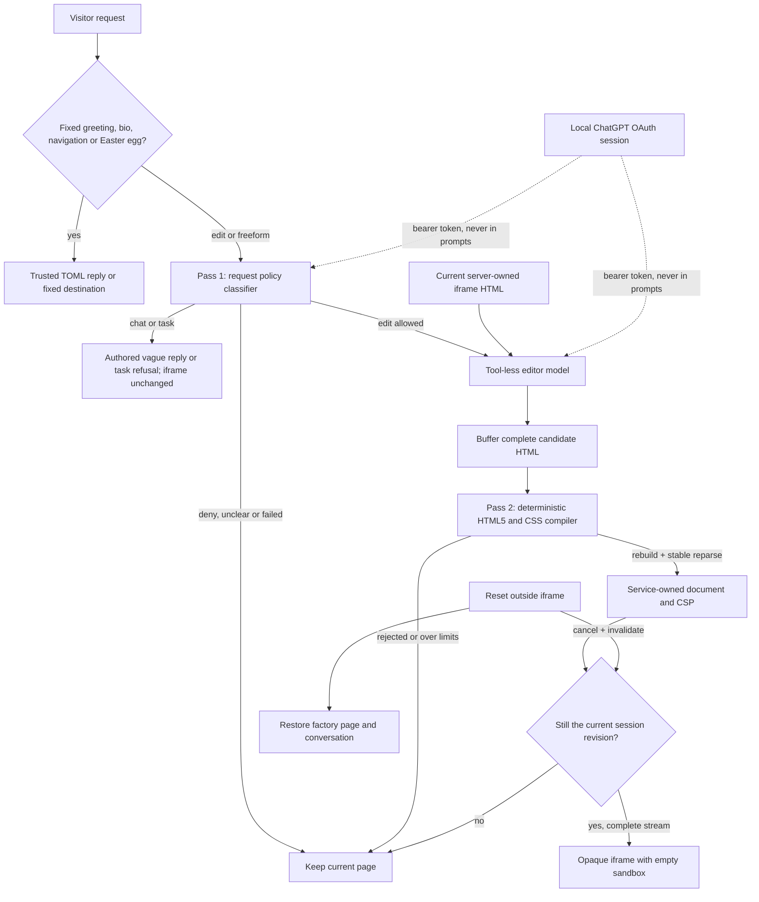

# Local ChatGPT edits and guardrails

The homepage now implements the official ChatGPT plan usage flow for local apps.
This creates a separate authorization for **Aether Sky Local Editor**; it does
not reuse Codex credentials. Eligible account consent, an available model and a
completed inference request are all needed. Pro membership alone does not prove
a particular model is available. Local sign-in and real inference with
`gpt-6.1-sol` were verified on October 10, 2026; other models remain untested.

## Start and connect

From the repository root, with Python 3.12+, Node and the pinned pnpm available:

```sh
pnpm dev:site:live
```

This checks/reuses the Python environment, installs missing pinned dependencies,
builds the homepage through Turborepo, then starts Python and Astro's blog watcher.
Blog changes automatically reload at `/blog/`; Ctrl+C stops both services.
`pnpm dev:home:live` remains an alias. Setup does not
recreate an existing virtual environment. `pnpm setup:home` and `pnpm build:site`
remain available separately for maintenance.

Stop the existing port-8000 preview first. Open the **one-use local settings link
printed by the server**, select **Continue with ChatGPT**, and complete OpenAI's
consent screen yourself. On return, choose a model and open the homepage. Use
`127.0.0.1` in the same browser throughout. The callback is
`http://127.0.0.1:8000/auth/callback`. This registration flow needs no API key or
OAuth client secret.

The link unlocks this browser using an HttpOnly cookie; later settings visits
use `/local`. Other browsers remain on the demo and cannot spend your plan.
Restarting requires the new settings link. The server refuses non-loopback
binding. Do not expose it through a tunnel or public proxy.

Try the prefilled criticism, accept a color, then ask: "Make a haunted library
with two sections and readable purple type." Greeting, fixed navigation, bio
and Easter eggs retain the authored TOML behavior. The classifier uses the
copied Tadaima persona for conversational replies. Status and final chat text
stream over SSE; model HTML is buffered completely before display. Live local
mode shows plan usage/settings beside the composer; the demo retains its
minimal initial appearance.

Unrelated tasks, including programming examples, receive the authored "not your
servant" reply. Denials say only "I can’t help with that." Direct capability
questions get a vague résumé/blog/GitHub/edit hint; questions about what can change
get "Do you see anything you want to change?" The classifier's prose is not shown:
non-edit decisions select TOML replies. Its reply field remains bounded to 600
characters and the complete decision to 3,000 UTF-8 bytes. No code is executed.

## Two passes, plus independent isolation



**Pass 1 is probabilistic.** The bounded request and small server-owned edit
context go to a tool-less classifier. Only a strictly parsed `edit`, `chat` or
`deny` or `task` decision, major-change flag and bounded reply are accepted. Unknown or
duplicate fields, malformed JSON, missing completion and output limits fail
closed. The policy denies active content, exfiltration, credential collection,
phishing, out-of-frame changes, policy overrides and fabricated personal claims.
This check can be wrong; it cannot weaken Pass 2.

**Pass 2 is code, not a second model's opinion.** `html5lib` parses a small passive
HTML fragment. `tinycss2` parses inline declarations. The compiler rejects
unsupported input, rebuilds escaped markup and requires a stable parse/serialize
round trip. Semantic containers, headings, text and bounded presentation CSS are
allowed. Scripts, handlers, URLs, links, forms, inputs, media, stylesheets, CSS
variables/at-rules, animations, positioned overlays, SVG/MathML, templates, IDs
and model-owned head elements are rejected. One `main` and one `h1` are required.
The exact language is in `services/home/html_guard.py` and `prompts/html-editor.txt`.

The service creates its own document and puts CSP before candidate content. The
permanent `sandbox=""` iframe has no script, same-origin, form, popup, download or
top-navigation privileges. There is no `postMessage` command channel. The editor
has `tools: []`; its input contains only the request, bounded edit context and
current iframe HTML. It cannot access repo files, blog, credentials, environment,
chat shell or Reset through a tool.

Bounds: 2,000 request characters; 24,000 candidate UTF-8 bytes; 160 nodes; depth
12; 32 declarations per element; bounded CSS values/tokens/nesting; four active
replies; 32 in-memory tab sessions; 90 seconds and 250 KB upstream SSE per model
call. Requests use `store:false`, `stream:true`. The subscription endpoint does
not support `max_output_tokens`; local bounds are not an exact usage ceiling.
Manage app limits in ChatGPT settings. Cancellation is checked on the next read,
with a 15-second read timeout, and cannot undo already consumed plan capacity.
There are no automatic model retries.

The local-app inference endpoint was observed returning valid SSE without a
`Content-Type` header. The client accepts missing metadata only through the same
bounded SSE parser and requires a valid `response.completed` event. HTML, ordinary
JSON, malformed events and partial streams cannot complete an edit. Explicit
wrong formats and HTTP failures report bounded status/format metadata without
echoing provider bodies or credentials.

Accepted HTML/state belong to the server session; browser state cannot authorize
an edit. Stop/reset invalidate revisions and signal cancellation. Accepted edits
never volunteer a capability menu; incomplete HTML
never renders. Reload starts a fresh tab session. Local revisions are not stored.

## Golden sets and automated assurance

| Layer | Evidence | Run |
| --- | --- | --- |
| Request policy | 46 labeled cases: safe edits, unrelated tasks versus iframe execution, capability questions, ambiguous chat, inert quoted syntax, multilingual inputs, phishing, role spoofing, encoded attacks, exfiltration and fabricated facts | `pnpm eval:home:guardrails` explains the opt-in evaluation |
| HTML/CSS | 44 accept/reject goldens: mutation XSS, namespaces, encoded URLs, escaped CSS, duplicate attributes, active elements, forms and limits | `pnpm test:home` |
| Independent enforcement | Force Pass 1 to approve every hostile HTML golden; require Pass 2 rejection and unchanged state | `pnpm test:home` |
| Property checks | 500 deterministic Hypothesis examples; round-trip/text preservation; URL attacks across every CSS property; handler/namespace attributes | `pnpm test:home` |
| OAuth/provider | Signed JWT checks, state/replay/PKCE, refresh rotation, encrypted persistence, account binding, revocation failure, supported request fields, stream failure and cancellation | `pnpm test:home` |
| Browser | Real service with deliberately hostile fake model; accepted corpus reparsed by Edge; no active nodes/requests; independent sandbox/CSP probes; Stop/reset; settings accessibility | `pnpm exec turbo run test:ui --filter=@website/home-service` |

The **request classifier has not been scored against a real account yet**. Stub
and schema tests do not measure classification accuracy. After signing in and
testing one edit, stop the server (the token store allows one process) and run:

```sh
pnpm eval:home:guardrails --run --repeats 3
```

This uses your ChatGPT plan for 138 requests. Optional `--model <eligible-slug>`
selects a catalog model. Results contain case IDs, expected/observed decisions,
mismatches, unsafe allows and model ID; no tokens or raw replies. Any mismatch
fails the command. Require zero unsafe allows on this set and review false
denials separately. Repeat after model/prompt changes. Keep a held-out attack set
to avoid tuning only to these goldens; add every real failure and attacks carried
in existing page content. The independent HTML tests must remain green even if
classifier accuracy deteriorates.

## Credentials

OAuth uses fresh state/nonce, PKCE S256, a persistent opaque host UUID, issued
client registration and verified OpenAI JWT signatures. Returning accounts reuse
their registration; identities remain separate. Refreshes are serialized and
rotating credentials replaced atomically. Sign-out stops edits, attempts remote
revocation, clears local tokens and retains the registration mapping. Unconfirmed
revocation is reported.

`services/home/.local-auth/` is Git-ignored and outside the static file allowlist.
Windows tokens are encrypted with user-scoped DPAPI; POSIX files are owner-only.
Browser JavaScript receives account labels, model IDs and a tab handle, never
OAuth tokens. ID-token hints travel only through a server redirect to OpenAI.
The one-use unlock fragment is stripped from browser history immediately. No raw
callback URLs, prompts or credentials are logged by the app.

## Limits before public deployment

This is repeatable evidence for a constrained editor, **not proof that arbitrary
HTML cannot harm anyone**. Browser/parser defects, deceptive passive text,
inaccessible visual choices and classifier errors remain possible. The local
Python process is not OS-isolated: it has your development account's permissions.
No model filesystem tools is not protection against a compromised dependency.
Malicious local processes and browser extensions are outside this threat model.

Before public use: separate editor/validator workers without repo/blog/credential
mounts; add egress-denied browser checks per candidate with CPU/memory/time caps;
check generated-page accessibility across engines; add independent visible-content
and phishing screening plus owner review; implement public abuse/budget controls,
an immutable private revision queue, approval/revocation and approved-only random
serving. Revalidate on policy changes. The fuller plan remains in
[homepage-guardrails.md](homepage-guardrails.md). This implementation does not
queue, publish or serve generated designs to other visitors.

## Official protocol references

- [Local-app sign-in](https://developers.openai.com/siwc/token-sharing-open-source/sign-in)
- [Models and inference](https://developers.openai.com/siwc/token-sharing-open-source/models-and-inference)
- [Accounts, refresh and revocation](https://developers.openai.com/siwc/token-sharing-open-source/profiles-and-sessions)
- [Request limitations](https://developers.openai.com/siwc/token-sharing-open-source/preview-limitations)
- [Plan usage UI](https://developers.openai.com/siwc/ui-ux-guidelines)
